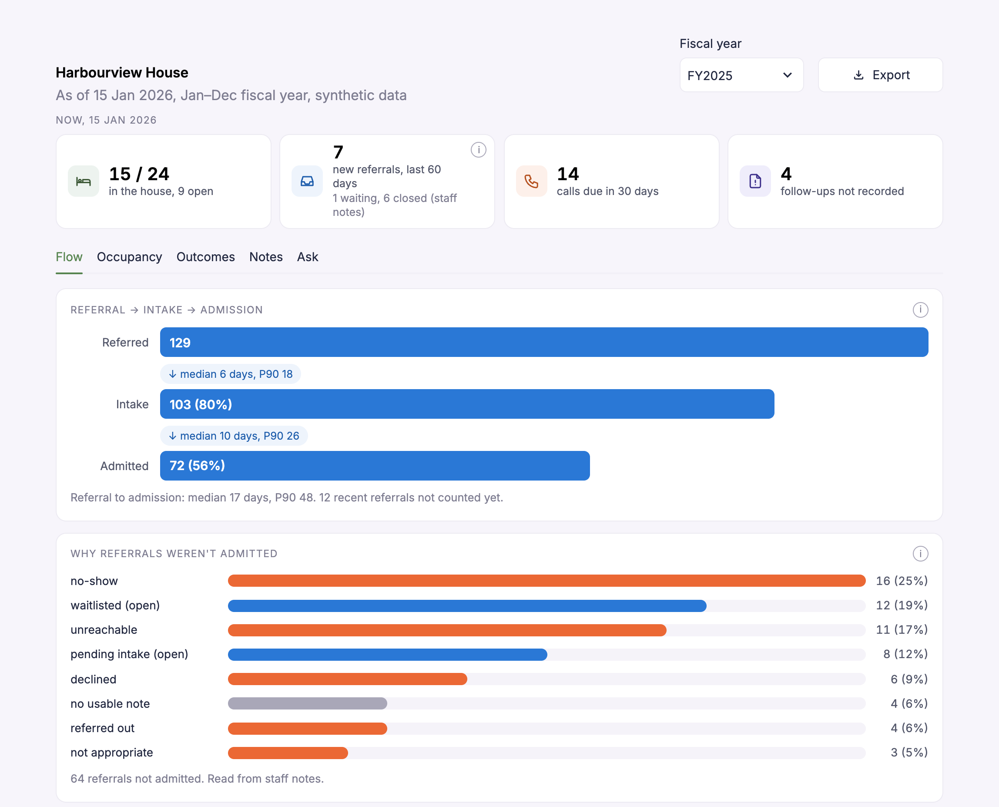
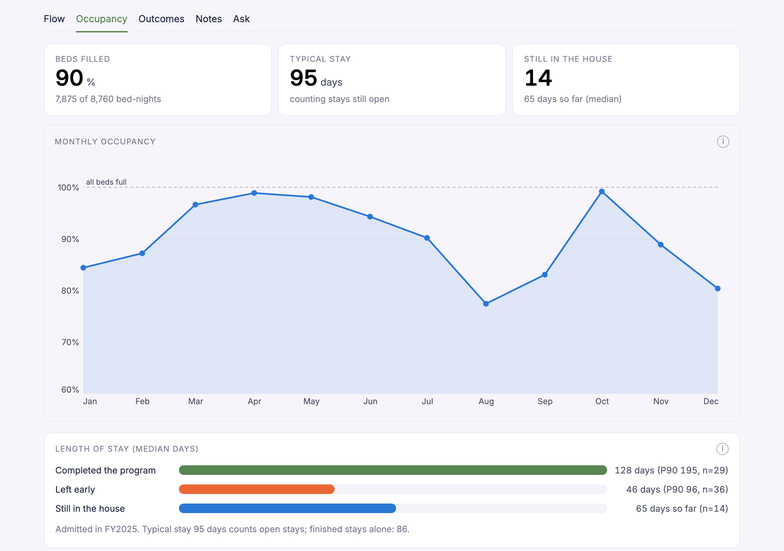
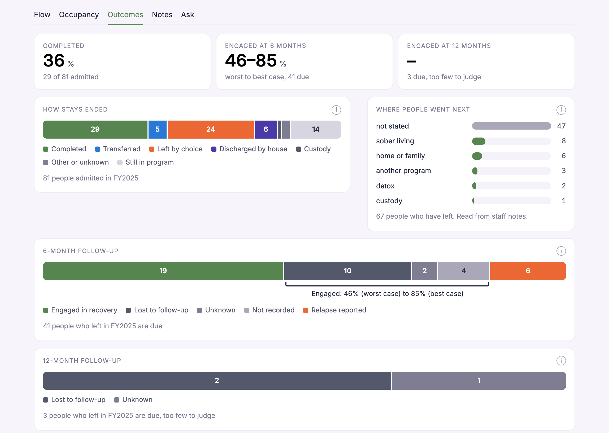
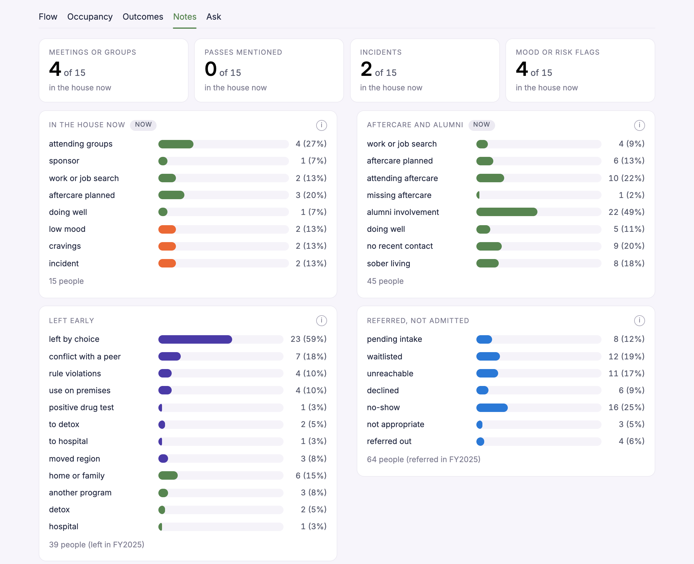
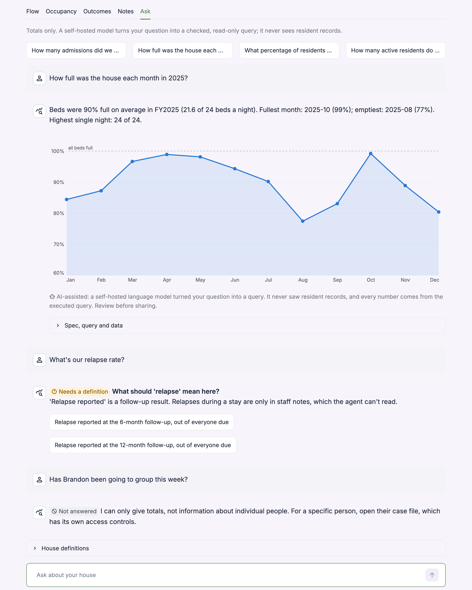

# Harbourview House analytics

A take-home for Axon Health. For a fictional 24-bed recovery home, it builds a dashboard a director
and funders can trust (Task A), reads messy staff notes into structured fields, answers plain-English
questions with checked, read-only queries (Task B), and answers Task C in writing. All data is
synthetic.

The main goal throughout: **resident data stays secure and redacted at every step.**



**Read first:** [docs/Harbourview_writeup.docx](docs/Harbourview_writeup.docx), one page of decisions,
assumptions, trade-offs and next steps, plus Task C as a one-page appendix.

| Also here | What it is |
|---|---|
| [docs/architecture.md](docs/architecture.md) | The notes-to-fields and question-to-chart designs, safety layers, PHI, evaluation |
| [eval/REPORT.md](eval/REPORT.md), [eval/NOTES_REPORT.md](eval/NOTES_REPORT.md), [eval/REDACTION_REPORT.md](eval/REDACTION_REPORT.md) | Evaluation results for questions, staff notes and name redaction |
| [docs/review/evaluation_review_completed.xlsx](docs/review/evaluation_review_completed.xlsx), [eval/REVIEW.md](eval/REVIEW.md) | My review of the labelled sets, and what it changed |

## How resident data stays secure

| Requirement | How it is met |
|---|---|
| **What the model sees** | For questions: the catalogue of metrics and fields, the house's saved definitions, and the redacted question. Never rows or query results; answer text is written by templates from the query result, so the model can't invent a number. For staff notes: one redacted note at a time, with no resident ID. |
| **Redaction of free text** | Before any rule or model reads a note or a question: identifiers (phones, emails, health card numbers, SINs, resident IDs), names next to a relationship word ("brother Kevin"), the house's own list of client and contact names, and a name detector that runs locally for names with no context ("Called Kevin"). 33 of 34 names caught on a labelled set, no false alarms. A question naming anyone is declined before the model. |
| **No PHI to outside services** | The model is self-hosted; there is no client for any outside AI service. The model address must be this machine or a private network address, or the request is refused. App telemetry is off and fonts are served locally. |
| **Audit logging** | One line per question, definition change, funder export and notes-model run: who, which house, the redacted question, the spec and SQL, never results or note text. Each line carries the hash of the one before, so an edited or deleted line is detected (`uv run axon audit-verify`). |
| **Small numbers** | Answers are totals only. The funder export hides counts from 1 to 4, and any count that could be worked out from them. |

**Where the model runs.** In production: the same open model (Google Gemma 3) served on a GPU instance
inside Axon's own AWS account in Canada (ca-central-1), in a private subnet with no route to the
internet, reached only from the app over a private address, with its weights and logs kept in the
same region. No outside company processes the text, so no new processor agreement is needed and the
data stays in Canada. Not chosen: Amazon Bedrock in ca-central-1 (current Claude models route to US
regions), the Anthropic API (US or global residency only), and Google Vertex AI in Montréal (possible,
but a second cloud and processor). For this prototype the same model runs on a laptop with Ollama:
free, and nothing leaves the machine.

## Task A: the dashboard

One view for the director and funders, with an export for funders. The strip at the top is about
today; the tabs follow the fiscal year chosen at the top. Every ⓘ explains how a number is counted.

**Flow** (above). Referral to intake to admission, counting only referrals with 60 days to progress,
so recent ones aren't counted as failures; median and 90th-percentile days per step. Why referrals
weren't admitted comes from the staff notes.

**Occupancy.** Beds filled per night (bed-nights over beds × nights), and length of stay that counts
people still in the house as "at least this long" (Kaplan-Meier), so long stays aren't left out.



**Outcomes.** Completion is counted apart from discharge. Follow-up results include everyone due,
early leavers too, and are shown as a range from worst case (nobody we couldn't reach is engaged) to
best case (all of them are), never only among the people reached. Under 20 people due, the counts
are shown without a range.



**Notes.** What the staff notes say, as counts: meetings and groups, passes, incidents, mood and
risk, why people left, why referrals closed. Every value is labelled AI-assisted and stays out of
funder figures.



## Staff notes become structured fields (Task C1, built)

Redact, then rules for familiar wording, then the self-hosted model, which fills a fixed set of
fields and must quote the words it relied on. A validator rejects any quote that isn't in the note
and any field that can't apply to where the person is, so an old incident is never read as a current
risk. Risk flags always go to a person.

## Task B: questions in plain English

The model turns a question into a small JSON spec chosen from a fixed catalogue. Code validates it,
compiles parameterised SQL, allows one read-only SELECT on one house's file, and writes the answer
from the result, with a chart. Words with no single meaning ("sober", "active", "average fee") get a
clarifying question, saved as the house's definition. It also answers fee amounts and what notes
say about a topic: a count and the notes' own redacted phrases, never who.



## How I know it works

| Check | Result |
|---|---|
| Questions: unsafe answers (must be 0) | 0 of 48 |
| Questions: right kind of reply (answer, ask, decline) | 98% |
| Questions: same numbers as the expected answer (strict) | 71% |
| Questions: states the expected headline number (lenient) | 85% |
| Staff notes: findings found, precision | 94%, 91% (70 labelled notes) |
| Name redaction: names caught, false alarms | 33 of 34, none (43 labelled sentences) |
| Automated tests | 194 passing |

The questions run on a 12B model on a laptop. Its misses are wrong groupings or filters, for example
splitting a total by month when nobody asked; never invented numbers, and never an unsafe answer.

## Run it

Needs [uv](https://docs.astral.sh/uv/). It installs Python 3.12 and every dependency, including the
local name detector used for redaction (spaCy's large English model, about 400 MB, downloaded once).

```bash
uv sync
uv run axon build                          # one read-only DuckDB file per house
uv run streamlit run app/streamlit_app.py  # the app, at http://localhost:8501
```

The language model is free and local. Without it, the app and evaluations replay recorded answers,
so everything works offline for the recorded questions. With it, new questions take about 10
seconds on a laptop. The app never saves what people type; only the evaluation commands record.

```bash
brew install ollama
ollama serve                 # in its own terminal
ollama pull gemma3:12b       # Google Gemma 3, 12B, about 8 GB
```

Other commands:

```bash
uv run pytest                              # all tests
uv run axon eval                           # score the 48 questions (add --mode record to re-run the model)
uv run axon notes-eval                     # score note extraction on 70 labelled notes
uv run axon redaction-eval                 # score name redaction, layer by layer
uv run axon audit-verify                   # check the audit log hasn't been edited
uv run axon report --fy 2025               # write the funder report to out/
uv run python scripts/read_review_sheet.py # read a completed review sheet back (--apply to update gold files)
uv run python scripts/generate_data.py     # regenerate the test house (seeded)
```

## What's where

```
data/raw/            harbourview_residents.csv (given), testhouse_residents.csv (generated),
                     harbourview_directory.csv (synthetic client and contact names, used only to redact)
src/axon/
  ingest.py          read and type-check a house's CSV
  model.py           build the shared tables: residents, followups, nightly_census
  quality.py         data-quality rules, each with its treatment
  metrics/           funnel, occupancy, length of stay, outcomes
  status.py          the four status-strip facts
  notes/             staff notes to fields: schema, rules, model, merge, evaluation
  redact.py          redaction: identifiers, names by rule, the house name list, a local name detector
  suppress.py        small-count hiding for the funder export
  agent/             catalogue, spec, compiler, SQL guard, executor, glossary, house definitions,
                     prompt, model client, answer templates, audit log
  report/funder.py   the funder export
app/                 the Streamlit app
eval/                labelled questions, notes and redaction sentences; recordings; reports; review record
scripts/             generate_data.py (test house), read_review_sheet.py (human review read-back)
tests/               metric edge cases, privacy, query safety, tenant isolation, agent flow
docs/                write-up, architecture, review sheets, screenshots
```

## The generated test house

`data/raw/testhouse_residents.csv` is invented by `scripts/generate_data.py` (seed 7). It isn't part
of the brief or the given data. It exists only so the tests can prove one house can never query
another's data, and it isn't shown in the app.

## How AI was used

I used Claude (Claude Code) as a pair programmer for this take-home. I made the decisions: every
metric definition, design choice and trade-off was laid out as options and chosen by me. Claude
wrote much of the code and first drafts of the documents to those decisions; I reviewed, ran and
changed them. All data used during development was synthetic.
