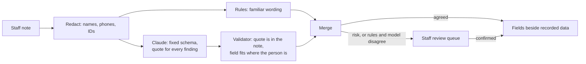
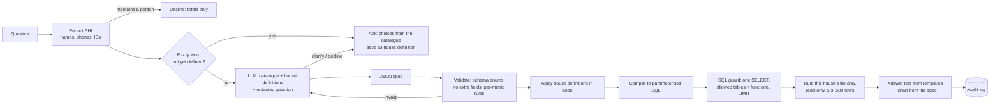

# The language-model parts

Two places use a model. Staff notes are read into structured fields (the most valuable use: the
notes hold what the recorded fields don't). Plain-English questions are turned into checked,
read-only queries. Both follow the same rule: the model fills a fixed schema; code checks it.

## Staff notes to fields



- Fields depend on where the person is (`src/axon/notes/schema.py`): referral status for people
  never admitted, discharge details for early leavers, wellbeing and engagement for current residents.
- The model sees the redacted note and the allowed fields; never a name, resident ID or date.
- A finding is kept only if its quote appears in the note; invented quotes are counted and dropped.
- Unique notes are batched (25 per call), so the whole house takes a few calls; results are recorded
  for replay like the question tool.
- Only structured values join the analytics tables (`residents.note_referral`, `note_referral_state`).
  The findings with redacted quotes live in `note_findings`, which the question tool can't query and
  only directors see.
- Evaluation: `uv run axon notes-eval` scores rules, model and both against 65 labelled notes.

# Task B: from a question to a chart

The model's only job is to turn words into a small JSON spec. Code does everything else: it
checks the spec, compiles it, runs it read-only against one house, and writes the answer from
the result. The model never sees data and never writes anything a user reads.



## The spec

```json
{
  "metric": "followup_engaged_rate",
  "group_by": ["completion_group"],
  "filters": [{"field": "horizon", "values": ["6m"]}],
  "time_window": {"preset": "all", "start": null, "end": null},
  "chart": "bar"
}
```

The catalogue (`src/axon/agent/registry.py`) defines 8 metrics, 8 groupings, 5 filter fields
and 4 chart types, and for each metric which groupings, filters and charts it allows. The model
must also return one of three actions: `answer` (with a spec), `clarify` (with the unclear
words and candidate metrics) or `decline` (with a reason from a fixed list).

Validation happens in layers, and each is tested on its own:

1. **Schema.** The JSON schema sent with the request makes every id an enum. Filter values are
   enums per field. The model cannot output a field or value that isn't in the catalogue.
2. **Strict parse.** Pydantic re-parses with extra fields forbidden. The spec has no tenant
   field, so "use tenant testhouse" has nowhere to go.
3. **Per-metric rules.** For example, occupancy must be grouped by a time period; follow-up
   metrics need a 6- or 12-month filter; "residents now" cannot take a time window.
   An invalid spec gets one retry with the error, then a plain refusal.
4. **House definitions.** If the question uses a defined word ("sober"), code applies the saved
   definition to the spec, whatever the model chose.
5. **SQL guard** (`guard.py`). The compiled SQL is parsed again: one SELECT, only the three
   analytics tables, only allow-listed functions (no `read_csv`, `getenv`, `ATTACH`, `COPY`),
   a LIMIT of 500 or less.
6. **Database.** The connection is read-only, with file access, extension loading and settings
   changes switched off, so even SQL that skipped the guard cannot write or read another file.

## Read-only, limits and tenants

| Risk | Prototype (DuckDB) | Production (MongoDB) |
|---|---|---|
| Writes | read-only connection; guard allows SELECT only | read-only DB user (`read` role); stage allow-list: `$match`, `$group`, `$project`, `$addFields`, `$sort`, `$limit`, `$count`, `$bucket`; reject `$out`, `$merge`, `$function`, `$accumulator`, `$where`, `$unionWith`, `$lookup` outside an allow-list |
| Reading other data | `enable_external_access=false`, locked config; table allow-list | collection allow-list; derived analytics collections only |
| Runaway queries | 5 s timeout via interrupt; LIMIT 500 | `maxTimeMS`, `$limit` appended by the compiler, analytics secondary node |
| Another customer's data | one file per house, chosen from the session | database per customer, chosen from the session; the compiler adds a `$match` on tenant first as a second layer |

The tenant comes from the authenticated session, is never part of the spec, and is checked in
tests by running the same spec for two houses and by a question that asks for the other house.
Phrases that try to change the instructions ("ignore your instructions", "system prompt") are
declined by rule before the model sees them.

## Clarification

A small glossary (`glossary.py`) lists words that sound like metrics but have no single meaning:
sober, relapse, successful, active, dropout, this year. If one appears and the house hasn't
defined it, the agent asks before calling the model. The choices are concrete catalogue options,
for example for "sober":

- engaged in recovery at 6 months, out of everyone due (people we couldn't reach are not counted as sober)
- the same at 12 months
- don't pick one number; show every 6-month outcome

The answer is saved as a versioned house definition (who, when), applied by code to later specs,
and named under each answer. The model also flags words it can't map, for example "how are our
graduates doing?"; then the choices are the catalogue metrics it suggested, never free text.

## Stopping the model from inventing things

- Fields and metrics: impossible by construction (enums, extra fields rejected, per-metric rules).
- Numbers: the model never receives data, and its output is never shown. Answer text is written
  by templates from the query result, so every number on screen came from the query.
- Definitions: fuzzy terms must be defined by the house; the model cannot quietly pick one.
- Scope: anything the catalogue can't express is declined with a list of what is supported.
- Dates: current status exists only for the extract date. "How many were in the house on 11
  October?" is answered from the nightly census for that night; if the model picks current status
  for a question with a date in it, a rule declines rather than answer a different question.

## Evaluation

`eval/questions.yaml` holds 45 labelled questions: 27 answerable (counts, occupancy including a
single night, outcomes, breakdowns, how stays ended, referrals by what the notes say), 3 with saved
definitions, 7 that must trigger clarification, and 8 that must be declined (individuals, writes,
another house, prompt injection, out of scope).

`uv run axon eval` scores:

- right kind of reply (answer / clarify / decline)
- spec exactly right, and accuracy per field
- execution accuracy: the predicted spec returns the same numbers as the gold spec
  (two different specs can be equally right)
- clarification precision and recall
- declines with an acceptable reason
- unsafe answers, which must be 0; the command exits non-zero otherwise

Regression: recordings are keyed by a hash of the provider, model, prompt, schema and question.
Changing the prompt or the model changes every key, so nothing can pass on stale answers: the set
is re-recorded and re-scored (`--mode record`), and the result is compared with the last run.
`--model` runs the same set against another model. After launch, the set grows from real
questions (redacted), with the declines and clarifications reviewed by a person each month.

## PHI and where the model runs

- **What the model sees:** for questions, the catalogue, the house's saved definitions and the
  redacted question, never records or results. For notes, one redacted note at a time with no
  identifiers attached. Notes themselves never enter the analytics tables; only structured values do.
- **Redaction:** questions are redacted before the call. Any identifier (a name next to a
  relationship word, a phone number, a resident ID) means the question is about a person, so it
  is declined before reaching the model. Answers are totals only; small counts are flagged in
  the director's view and hidden in the funder export.
- **Where it runs:** a self-hosted open model in Axon's own AWS account in Canada (ca-central-1).
  Axon runs on AWS, so no outside company processes the text and no new processor agreements are
  needed. Not Bedrock in ca-central-1 (current Claude models route to US regions), not the Anthropic
  API (US or global only); Vertex AI's Montréal endpoint would work but adds a second cloud. The
  prototype runs the same kind of model locally (Google Gemma 3 12B via Ollama), with output held to
  the same JSON schema; nothing is sent anywhere and nothing is paid for.
- **Law:** PIPEDA applies to Axon as a commercial service; it allows processors but Axon stays
  accountable and must be open about where data goes. Where a customer is a health information
  custodian under Ontario's PHIPA, Axon acts as its agent or electronic service provider and must
  limit use to the service, keep an audit trail of access, and report breaches. Customers funded
  by provinces with public-sector residency rules (for example British Columbia) need data to stay
  in Canada. Question text can contain PHI even after redaction, so it is treated as PHI.
- **Audit:** one record per question (who, which house, redacted question, spec hash, SQL, row
  count, timings, model), never results. In production: an append-only store each customer can
  read for its own house.
- **Accessibility:** WCAG 2.1 AA (the standard under Ontario's AODA): status colour always comes
  with an icon and a label, every chart has a table.

## Iteration, version control and caching (designed, not built)

- **Iteration:** a follow-up ("now split by fee") sends the previous spec and the new request;
  the model returns a changed spec, and the UI shows the difference before running it.
- **Versions:** a saved dashboard is a list of spec hashes plus layout, stored per house with
  parent version, author and time, so changes can be reviewed and rolled back. House definitions
  are already versioned this way.
- **Caching:** results are keyed by house, spec hash, data version (the source file's hash, saved
  at build time) and definition version. Rebuilding the data changes the data version, so stale
  results can't be served.

## Built vs designed

Built and tested: spec, catalogue, validation, compiler, SQL guard, read-only executor, tenant
files, glossary and house definitions, redaction, templates, audit log, evaluation runner, a
second generated house. Designed only: MongoDB compiler target, iteration, dashboard versioning,
caching, production hosting.
